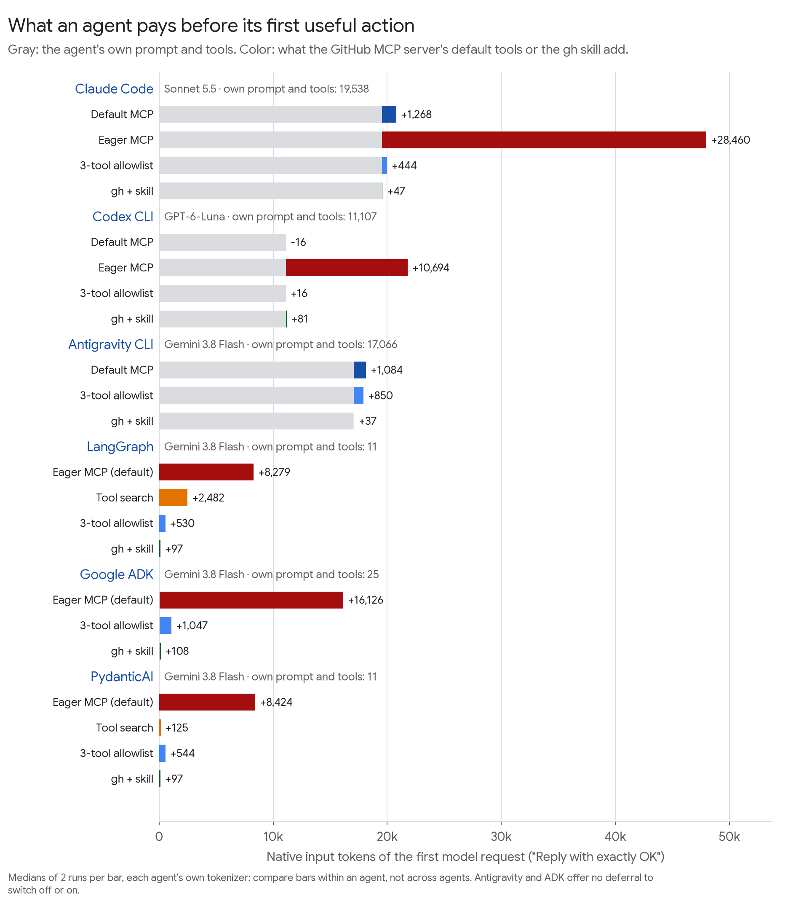

# MCP context benchmark

How much context does an MCP server really cost an agent, and when is a CLI cheaper? This repository measures the official [GitHub MCP server v2.0.2](https://github.com/github/github-mcp-server/releases/tag/v2.0.2) inside six agents, three coding harnesses and three frameworks, on two real GitHub tasks, with each agent's own token counts. It backs the article [Can MCP stop eating my context window?](https://www.fmind.dev/articles/mcp-context-window/).



## Results at a glance

Measurements of 2026-10-10. Native tokens come from each agent's own tokenizer: compare setups within an agent, not agents with each other.

| Question | Observation | Evidence |
| --- | --- | --- |
| How large is the catalogue? | 46 default tools: 11,157 reference tokens; 91 tools: 23,102; read-only: 6,461; a 3-tool allowlist: 708. Under MCP 2026-07-28, output schemas add 17,171 for the default set | [catalogue.json](results/catalogue.json) |
| What does the server add at startup? | Harness defaults defer tools: Claude Code +1,268 native tokens (+28,460 eager), Codex CLI -16 (+10,694 eager), Antigravity CLI +1,084 through its `call_mcp_tool` gateway. Frameworks load everything by default: LangGraph +8,279, ADK +16,126, PydanticAI +8,424 (+125 with `defer_loading()`). The `gh` skill adds 37 to 108. A harness's own prompt and tools weigh 11,107 to 19,538 tokens on every call; a framework's, 11 to 25 | [summary.md](results/summary.md) |
| What does a complete task cost? | `gh` with a skill was the cheapest setup in 9 of 12 agent and task pairs, saving 3% to 48% against each harness's default MCP setup. The 3-tool allowlist beat it on the issue task for Codex CLI (62,936 vs 64,947), LangGraph (9,667 vs 33,586), and PydanticAI (9,242 vs 45,917). Codex CLI's default used more input than eager loading on the issue task (124,703 vs 102,499) | [figures](results/figures/) |
| Does quality hold? | 264 of 276 runs passed. LangGraph's `LLMToolSelectorMiddleware` failed all 10 task runs with Gemini (invalid tool names); two CLI runs hit a provider disconnect. Of the runs that answered, CLI runs cited the right line range in 28 of 28, MCP runs in 40 of 75. No run was blocked, bypassed the designated interface, or read outside its workspace | [records.jsonl](results/records.jsonl) |
| What changes with MCP 2026-07-28? | Claude Code, Antigravity CLI, and PydanticAI negotiate it; Codex CLI, LangGraph, and ADK stay on 2025. Typed results shrink `get_release_by_tag` from 5,261 to 253 reference tokens but drop the release assets; every typed result arrives twice, as text and as structured content | [catalogue.json](results/catalogue.json), [preliminary runs](results/preliminary/release-assets.json) |
| Why do framework catalogues differ? | Same 46 tools: LangGraph 10,357, PydanticAI 11,097 (45 tools, MCP Apps tool hidden), ADK 17,930 reference tokens, because ADK fences every description as untrusted data | [declarations/](results/declarations/) |

## Layout

- [`bench/`](bench/): the study. `hosts.py` runs a harness, `<framework>_agent.py` runs a framework on the shared `frameworks.py`, `common.py` holds the tasks, answer key, and grading, `gate.py` and `gh_shim.py` keep GitHub read-only, `study.py` runs the schedule, `collect.py` sanitizes records, `catalogue.py` measures the server without a model, and `analyze.py` writes the summary and figures.
- [`results/`](results/): sanitized run records, summary, catalogue and result sizes, framework declarations, and figures.
- [`METHODS.md`](METHODS.md): design, isolation, grading, measurements, reproduction, and limits.

## Reproduce

Recompute the summary and figures from the retained records, with no credentials:

```bash
uv run --script bench/analyze.py results
python3 -m unittest discover -s bench -p 'test_*.py'
```

Rerunning the study needs the three harnesses with their logins, a Vertex AI project, an authenticated `gh`, and the verified server binary: see [METHODS.md](METHODS.md#reproduce). It performs model inference and real read-only GitHub calls.

## Earlier edition

The [September 2026 edition](https://github.com/fmind/mcp-context-benchmark/tree/v1.1.0) measured GitHub MCP server v1.12.2 with earlier harness versions, startup captures for CrewAI and goose, and a reference task harness. It stays in the history for reference.

## License

Original code and documentation are MIT-licensed. Third-party material keeps its notices: see [THIRD_PARTY.md](THIRD_PARTY.md). Credentials, raw agent streams, and third-party binaries are not included.
